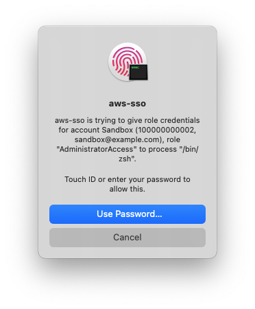

# aws-sso

Proof-of-concept tool to safely hold AWS SSO credentials in memory, and only hand them out with your Touch ID approval.

## Why

I've used [aws-vault](https://github.com/99designs/aws-vault) forever, and I like that it keeps the credentials away from the file system. This tool aims to solve two problems I have with aws-vault:

1. aws-vault hasn't been updated to use the newer PKCE auth method for SSO, and since the project seems to have been abandoned, I expect it probably won't be
2. aws-vault really just moves the problem: anything can execute it to extract credentials, and the only confirmation you can have is setting your keychain timeout quite low and having to type in your password again. I solve this by showing a Touch ID confirmation when credentials are requested, which includes details of the calling process and what credentials have been requested (see [Approval caching](#approval-caching)).



## Install

> [!CAUTION]
> I'm not a security expert. You probably shouldn't install this tool.

> [!NOTE]
> This tool only works on MacOS.

```bash
go install github.com/gordonmleigh/aws-sso
aws-sso agent install
```

The second command registers the [agent](#agent) with launchd. Run it again whenever you upgrade or move the binary: until you do, `aws-sso` refuses to talk to an agent from a different build, and tells you to run `aws-sso agent install`.

## Configure

Set up your AWS config file (`~/.aws/config`) with an `sso-profile` and whatever
`profile` sections you want:

```ini
# at least one [sso-session] block is required
[sso-session my-sso]
sso_region=eu-central-1
sso_start_url=https://my-sso-start-url.awsapps.com/start

# you can set up zero or more [profile] blocks for use with the AWS CLI and SDKs
[profile prod-admin]
region=eu-central-1
# refer to an account by name or ID:
credential_process=aws-sso -account Production -role AdministratorAccess -output=json
```

## Usage

### Interactive mode

To start a new shell with SSO credentials, simply run `aws-sso`. Without any arguments, you will be prompted to select an account and role.

You can optionally provide the account and/or role name as arguments:

```shell
$ aws-sso -account Production -role AdministratorAccess
```

You can specify the account as the ID (e.g. 100000000001), or the [Account Name](https://docs.aws.amazon.com/accounts/latest/reference/manage-acct-update-acct-name.html).

### Custom command

By default, aws-sso will run the shell given in the users `SHELL` environment variable. To run something different, add it after all of the options.

The `--` is optional.

```shell
$ aws-sso -account Production -- terraform plan
```

### Non-interactive mode

If you pass `-no-input` or `-output=json`, then no prompts will be shown. If the required values have not been provided as command line options, then you will see an error message and a non-zero exit code.

### JSON mode (`credential_process`)

Using the `-output=json` option will output a JSON format compatible with the [Process credential provider](https://docs.aws.amazon.com/sdkref/latest/guide/feature-process-credentials.html) option in the AWS Config file.

Use it like this:

```ini
# ~/.aws/config

[profile prod-admin]
region=eu-central-1
credential_process=aws-sso -output=json -account Production -role AdministratorAccess
```

### What needs approval

The agent asks for Touch ID approval, naming the calling process, before it:

- **Logs in through your browser**, which ends the previous SSO session. That way no process can open login pages without you seeing which one asked. The first login for an SSO session uses a new OIDC client, which is when AWS shows its consent page, and the prompt says so. A consent page is only expected straight after that prompt: if one appears without it, something else is running its own login, so don't allow it. Later logins reuse the same client (see [Agent](#agent)), so there's no consent page; the browser may just open and close if you're still signed in to your identity provider.
- **Gives out credentials** for an account and role.

Listing your accounts and roles, which the interactive account and role pickers need, doesn't need approval, because it doesn't give access to anything. It only works while you're logged in, or after you've approved the login it needs. The agent doesn't pass on the accounts' email addresses, which belong to their root users.

### Approval caching

When you approve a request with Touch ID, the agent remembers the approval for that exact calling process (the same process instance, running the same program with the same arguments), for the same account and role. By default, it's remembered until your SSO session ends: the next time the agent has to log in through your browser, every approval is forgotten and you'll be asked again. How long that is depends on the session duration your organisation has set in IAM Identity Center (8 hours by default).

The calling process is the parent of `aws-sso`: for `credential_process`, that's the tool asking for credentials, such as Terraform or the AWS CLI. A new process, even another run of the same command, will always prompt again. In interactive mode, it's the shell you ran `aws-sso` from, so running `aws-sso` again from the same terminal won't prompt again, but running it from a new terminal or a script will.

Approvals are kept only in the agent's memory, and are also forgotten as soon as the calling process exits or runs a different program, or the agent restarts.

Use `-approval-ttl` to remember approvals for a fixed time instead, counted from when you approved (or until the session ends, if that's sooner), or `-approval-ttl=0` to be prompted every time:

```ini
credential_process=aws-sso -output=json -approval-ttl=1h -account Production -role AdministratorAccess
```

The Touch ID prompt doesn't say how long the approval will be remembered.

### MCP proxy

`aws-sso mcp-proxy` is a stdio [MCP](https://modelcontextprotocol.io) server that passes requests on to a remote MCP server that uses SigV4 authentication, such as the AWS MCP Server. It does the same job as `mcp-proxy-for-aws`, but gets credentials straight from the agent instead of through `credential_process`.

It caches what the remote server lists (its tools, and any prompts and resources), so that MCP clients can start up and list them without any credentials. You're only asked to approve anything when a tool that needs AWS credentials is actually called (or a prompt or resource is fetched).

```json
{
  "mcpServers": {
    "aws-mcp": {
      "type": "stdio",
      "command": "aws-sso",
      "args": [
        "mcp-proxy",
        "-profile",
        "sandbox=Sandbox/ReadOnlyAccess",
        "-profile",
        "prod=Production/ReadOnlyAccess@us-east-1",
        "-region",
        "eu-central-1",
        "https://aws-mcp.us-east-1.api.aws/mcp"
      ]
    }
  }
}
```

Each `-profile` is `[name=]account/role[@region]`, where the account is an ID or name as for `-account`. The first profile is the default. With more than one, the tools that use AWS credentials get an extra `aws_profile` argument, so the model can choose which account each call runs in. The name defaults to the account as written.

The AWS region (sent as `AWS_REGION` in the request metadata) is the profile's `@region` if it has one, otherwise `-region`, otherwise the region `aws-sso` would use for anything else (`AWS_REGION`, then `region` in the default profile, then the SSO region).

The first time the proxy runs against a server (or after upgrading to a version that caches more), there's nothing cached yet, so it connects straight away and you'll be asked to approve the default profile. To avoid that, fill the cache ahead of time:

```shell
$ aws-sso mcp-proxy -profile Sandbox/ReadOnlyAccess -refresh https://aws-mcp.us-east-1.api.aws/mcp
```

After that, the cache is refreshed in the background whenever the proxy connects to the server anyway. The cache is kept in `~/Library/Caches/io.propulsionworks.aws-sso.agent/mcp/`, and holds nothing secret.

Unlike other uses of `aws-sso`, the process that's approved is the proxy itself, not the MCP client (e.g. Claude Code) that started it. So approving the proxy doesn't also approve anything else the MCP client runs, such as an `aws-sso -output=json` it runs itself. Each profile is approved the first time it's used, and remembered for that run of the proxy as described in [Approval caching](#approval-caching); if the MCP client restarts the server, you'll be asked again.

The approval prompt names the endpoint's host in full, and the app that started the proxy, e.g. "the MCP proxy for aws-mcp.us-east-1.api.aws, started by claude". Check the host, especially for MCP servers configured by a project you've cloned.

| Option                                    |                                                                                   |
| ----------------------------------------- | --------------------------------------------------------------------------------- |
| `-profile [name=]account/role[@region]`   | An account and role to sign with; repeatable (the first is the default)           |
| `-region region`                          | The AWS region for profiles that don't give their own                             |
| `-metadata key=value`                     | Add to the `_meta` of every request; repeatable                                   |
| `-sso-session name`                       | The SSO session to use, if there's more than one                                  |
| `-approval-ttl duration`                  | As for the main command                                                           |
| `-refresh`                                | Connect, cache the server's lists, and exit                                       |
| `-cache path`                             | Where to cache the server's lists                                                 |
| `-service name`, `-signing-region region` | Override the SigV4 service and region, which are normally taken from the endpoint |
| `-debug`                                  | Log debug messages to stderr                                                      |

### Agent

A small background agent (`aws-sso agent`) does all the SSO work: it logs in through your browser, holds the tokens, shows the Touch ID prompts and hands out role credentials. launchd starts it on demand when `aws-sso` first connects to it. If the agent isn't installed, `aws-sso` fails with a message asking you to run `aws-sso agent install`.

The SSO tokens and credentials only exist in the agent's memory, and `aws-sso` itself only ever sees the role credentials you approve. The trade-off is that you'll need to log in through the browser again whenever the agent restarts, which happens when you reboot, log out, or reinstall the agent (including after upgrading `aws-sso`).

The only thing stored is the agent's OIDC client registration for each SSO session, which is kept in your login keychain (it's no use without you logging in). It's only stored once you've logged in with it, and AWS only shows its consent page for a new client, so you'll normally only see a consent page (and the prompt before it) the first time. After upgrading `aws-sso`, macOS may ask whether to let it use the keychain item, since the binary has changed.

The agent identifies the calling process itself from the kernel, rather than trusting what it's told, and `aws-sso` and the agent each check that the other end of the connection is running the same code. This means other programs can't ask the agent for approval directly, or pretend to be the agent.

| Command                          |                                                                 |
| -------------------------------- | --------------------------------------------------------------- |
| `aws-sso agent install`          | Register the agent with launchd (replaces any previous install) |
| `aws-sso agent install -debug`   | The same, with the agent logging debug messages                 |
| `aws-sso agent uninstall`        | Remove the agent from launchd                                   |

The agent logs every approval and denial to `~/Library/Logs/io.propulsionworks.aws-sso.agent.log`. Install it with `-debug` to log what it's doing in more detail, such as token refreshes and cached approvals. Reinstalling restarts the agent, so you'll need to log in again.

To run a program called `agent` or `mcp-proxy` as a [custom command](#custom-command), put `--` before it: `aws-sso -- agent`.
